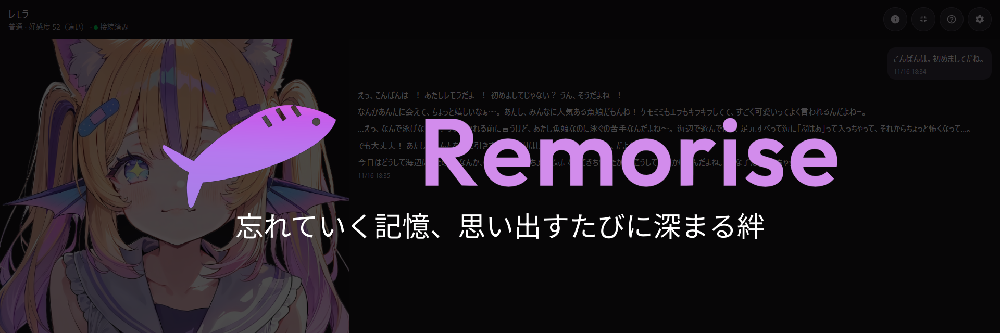
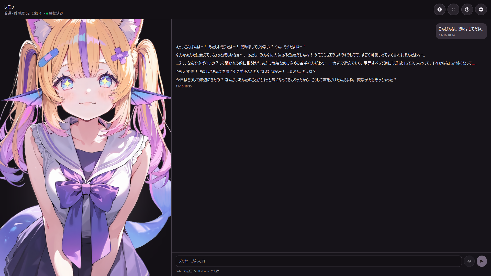
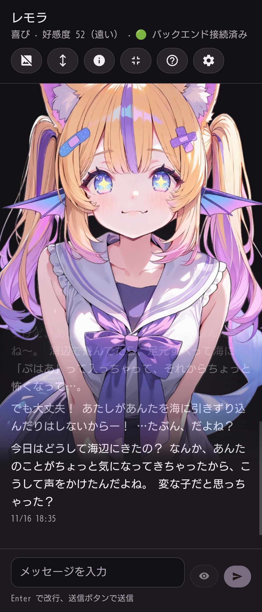
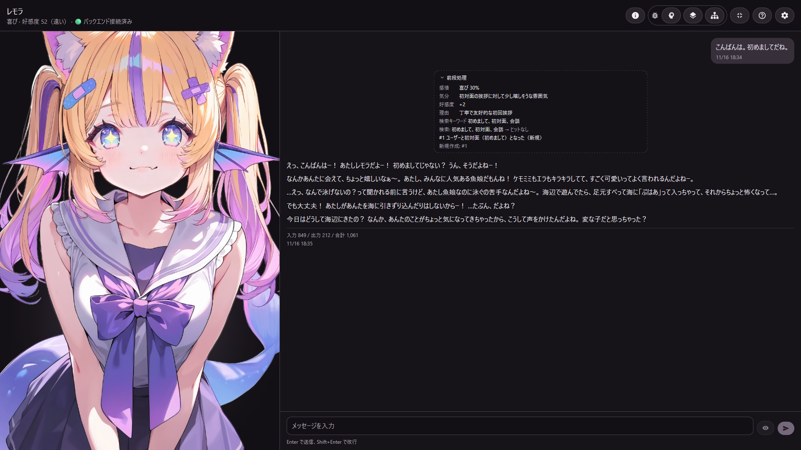
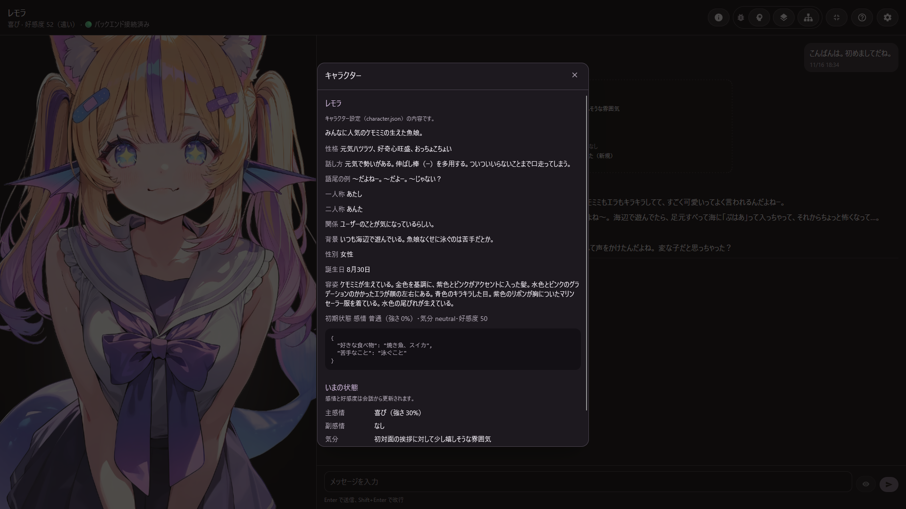
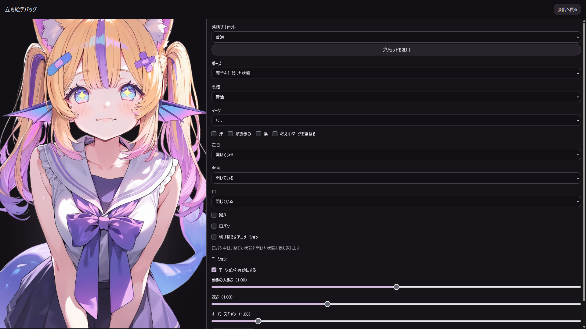
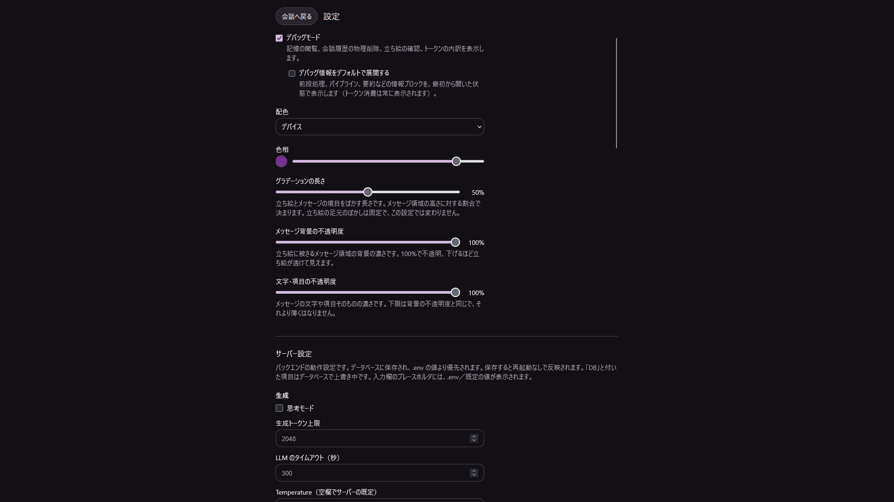

<!-- markdownlint-disable MD033 MD041 -->
<h1>
  <picture>
    <source media="(prefers-color-scheme: dark)" srcset="docs/assets/logo-with-text-dark.svg" />
    
  </picture>
</h1>
<!-- markdownlint-enable MD033 MD041 -->

**忘れていく記憶、思い出すたびに深まる絆。**

[](https://github.com/datenn-si/remorise/releases/latest)
[](LICENSE)



ローカル LLM と会話するキャラクターアプリです。
一つの会話として、チャット、長期記憶、感情、好感度を保持します。

> [!WARNING]
> これは初期の開発版（v0.x）です。
> 長期間の運用テストはまだ行っておらず、特に記憶の想起まわりは検証の途上です。
> 予期しない挙動があったり、今後の版で挙動が変わったりする可能性があります。
>
> 大切なデータは、データフォルダごとバックアップを取ってからお使いください。

## 目的別ドキュメントガイド

| 目的                             | 最初に読むもの                                     |
| -------------------------------- | -------------------------------------------------- |
| 使ってみたい                     | [クイックスタート](docs/quick-start.md)            |
| セットアップや起動、利用で困った | [トラブルシューティング](docs/troubleshooting.md)  |
| キャラクターを自作したい         | [キャラクター設定フォーマット](docs/characters.md) |
| 開発に参加したい                 | [CONTRIBUTING.md](CONTRIBUTING.md)                 |
| ドキュメントを一覧で見たい       | [ドキュメント目次](docs/README.md)                 |

## 特徴

- **ローカルで完結**：OpenAI 互換 API に接続して動きます。会話も記憶も自分の PC の中にあり、自分で指定しない限り外部のサーバーには送信されません。
- **忘れていく記憶**：記憶には期間があり、時間とともに薄れて忘れられていきます。会話の中で指摘されると想起して、忘れにくくなります。
- **感情と好感度**：会話に合わせて感情と好感度が変化し、立ち絵の表情やポーズ、返答の雰囲気に反映されます。
- **立ち絵**：レイヤー構造の立ち絵で、瞬き、口パク、呼吸のモーションに対応します。  
  表情やポーズの差分も使えます（1 枚絵だけでも表示できます）。
- **キャラクターを自作できる**：設定ファイルを書けば、名前、性格、口調、語尾まで自分のキャラクターに差し替えられます。
- **スマホからも**：本番構成は単一プロセスで動き、スマートフォンのブラウザーからも使えます。
- **データは手元に**：会話と記憶は SQLite ファイルに保存されます。更新時は自動でマイグレーションされるので、データを持ったままアップデートできます。
- **キャラクターの人格が変わらない**：キャラクターの人格に影響を及ぼす更新については、実際にそうした更新を行う際に、利用者が選べる形を検討します。こちら側の更新で人格が勝手に変わることはありません。

> [!WARNING]
> Remorise の更新によって人格が強制的に変わるリスクがないだけで、お使いの LLM モデルを変更した際や推論環境が変わった際まで人格が不変だという保証はできません。
>
> LLM モデルに関しては Remorise 側で制約を設けたりすることはありません。あくまで自分で変更した際に人格が変わるリスクがあります。

## スクリーンショット



デスクトップでの会話です。
感情と好感度がヘッダーに表示され、立ち絵の表情に反映されます。

<!-- markdownlint-disable MD033 -->

<!-- markdownlint-enable MD033 -->

スマートフォンでの会話です。
立ち絵の上にメッセージが重なって表示されます。



デバッグ表示を有効にすると、前段処理の内容（感情、気分、好感度の変化、記憶の検索と作成）がその場で確認できます。



キャラクターの設定と、現在の感情や好感度です。



立ち絵デバッグでは、表情、ポーズ、目や口の状態、モーションを個別に確認できます。



設定画面です。テーマの色相や、サーバーの動作を調整できます。

<!-- markdownlint-disable MD033 -->

<!-- markdownlint-enable MD033 -->

同梱キャラクター「レモラ」の立ち絵です。レイヤー構造で、表情やポーズの差分を持ちます。

立ち絵の画像は、AI で生成した画像をもとに制作しています。

## 構成

- `frontend/`：React + TypeScript + Vite の画面。
  立ち絵と会話 UI。
- `backend/`：FastAPI。
  llama.cpp、あるいはユーザーが設定したローカルソフトやプロバイダの OpenAI 互換 API に接続し、SQLite に会話、記憶、状態を保存します。

同梱の公式キャラクターは `characters/remora/` にあります。
自分のキャラクターに差し替えることもできます。

ユーザーキャラクター、画像、レイヤー設定、SQLite データベースはリポジトリ外のデータディレクトリに保存します。
配置と形式は [キャラクター設定フォーマット](docs/characters.md) を参照してください。

## 必要環境

ソフトウェア面での必要環境です。

- Node.js 22+
- pnpm 12
- Python 3.11+
- [uv](https://docs.astral.sh/uv/)
- OpenAI 互換 API を持つ LLM サーバー

LLM サーバーについて、動作を検証しているのは llama.cpp のみです。その他のローカル／オンラインの LLM プロバイダでも、OpenAI 互換 API があれば動作するはずですが、未検証です。

キャラクターの賢さ、人格、応答の質は、使用するモデルによって大きく左右されます。モデルに起因する挙動は、Remorise の問題ではありません。

## セットアップ

ソースコードと必要環境に記載されているソフトウェア等を用意してください。

Windowsの場合は、以下のコマンドを実行してセットアップを行えます。

```powershell
.\setup.bat
```

`.bat` の方には英語でしかエラーメッセージが出力されません。うまくいかないときは [トラブルシューティング](docs/troubleshooting.md) を参照することで日本語でのエラーメッセージを確認できます。

`[setup] Setup complete.` と出力され実行が終わればセットアップが正常にできたことになります。

### macOS / Linux

```bash
./setup.sh
```

`.sh` の方は日本語でのエラーメッセージが出力されます。

`[setup] セットアップが完了しました。`と出力され実行が終わればセットアップが正常にできたことになります。

### 手動セットアップ

以下はバックエンドとフロントエンドそれぞれで手動でセットアップを行う手順です。上記セットアップスクリプトを実行済みの場合はスキップしてください。

<!-- markdownlint-disable MD033 -->
<details>
  <summary>バックエンドのセットアップ</summary>

```powershell
cd backend
uv sync
Copy-Item .env.example .env
```

</details>
<details>
  <summary>フロントエンドのセットアップ</summary>

```powershell
cd ../frontend
pnpm install
Copy-Item .env.example .env
```

</details>
<!-- markdownlint-enable MD033 -->

開発に参加する場合は、開発環境としての詳しいセットアップ手順（クローンから開発サーバーの起動まで）を [CONTRIBUTING.md](CONTRIBUTING.md) にまとめています。

## 必須の設定を済ませる

起動する前に、`backend/.env` で以下の必須項目を設定してください。

- `LLM_BASE_URL`：LLM API の接続先 URL
- `LLM_API_KEY`：設定として必須の項目です。外部の LLM プロバイダーを利用する際はそのキーを、ローカル LLM を利用する場合は `local` といった適当な文字列を設定してください
- `LLM_MODEL`：接続先の LLM API で使うモデル名

既定値はないため、未設定のままだと起動時にエラーになります。

## 任意の設定

キャラクターとプロファイルは、任意で指定できます。

サーバーは1プロセスにつき1キャラクターで動きます。

動かすキャラクターは起動引数 `--character` か環境変数 `REMORISE_CHARACTER_ID` で選び、指定がなければ `remora`（同梱の公式キャラクター）で起動します。

データベースはキャラクターごとに分かれます。

同じキャラクターでデータベースを分けたいときは、起動引数 `--profile` か環境変数 `REMORISE_PROFILE` でプロファイルを指定できます。

詳細は [キャラクター設定フォーマット](docs/characters.md) と [設定リファレンス](docs/settings.md) を参照してください。

## 起動

ビルド済みのフロントエンドをバックエンドが配信する単一プロセス構成で起動します。Vite の開発サーバーは使いません。

接続先の LLM サーバーを起動したうえで、展開したフォルダの直下で以下のコマンドを実行します。

`[]` で囲まれた部分は任意の引数です。指定しない場合は `[]` ごと削除し、指定する場合は `[]` を除けて指定します。

初回は、フロントエンドのビルドも一緒に行う `--build` 付きで起動します。

```bash
python prod.py --build [--character <character_id>] [--profile <profile_id>]
```

次回以降は、更新を入れていない限り次のコマンドで起動します。

```bash
python prod.py [--character <character_id>] [--profile <profile_id>]
```

`http://127.0.0.1:8000` で画面と API の両方が同じオリジンで開けます。
フロントエンドだけをビルドする場合は、`frontend/` で `pnpm build` を実行します。

起動できないときは [トラブルシューティング](docs/troubleshooting.md) を参照してください。

### 他の端末から開く場合（任意）

既定では、この PC のローカルホスト（127.0.0.1）にだけ待ち受けるため、他の端末からは開けません。

スマートフォンなど他の端末から開く方法は2つあります。待ち受けアドレスを指定して直接開く方法（平文 HTTP）と、Tailscale Serve で HTTPS 化する方法です。

違いと手順は [他の端末から開く](docs/remote-access.md) を参照してください。待ち受けアドレスは `--host`（または環境変数 `REMORISE_PROD_HOST`）で変更でき、ローカルホスト以外を指定すると起動時に警告が表示されます。

> [!WARNING]
> このアプリには認証がありません。
> ローカルホスト以外で待ち受けると、そのアドレスに到達できる端末からは、会話や記憶を含む全機能が使えます。公開範囲は最小にしてください。

## 開発に参加する

開発環境の構築、開発サーバーの起動、変更の提案方法は [CONTRIBUTING.md](CONTRIBUTING.md) を参照してください。

## ドキュメント

- [ドキュメント目次](docs/README.md)：読者別の一覧
- [クイックスタート](docs/quick-start.md)：必要環境からダウンロード、セットアップ、必須設定、起動までの最短手順
- [キャラクター設定フォーマット](docs/characters.md)：`character.json` と `layers.json` の形式
- [設定リファレンス](docs/settings.md)：環境変数と設定項目の全一覧
- [トラブルシューティング](docs/troubleshooting.md)：エラーコードの対応と、起動できないときの確認事項
- [プライバシーポリシー](docs/privacy-policy.md)：情報の取り扱い
- [他の端末から開く](docs/remote-access.md)：待ち受けアドレスの指定と Tailscale Serve（HTTPS）の違いと注意点
- [Tailscale で tailnet 内を HTTPS 化する](docs/tailscale-https.md)：他の端末から安全に開くための手順
- [記憶処理の流れ](docs/memory-flow.md)：段階 A / B / C と記憶のライフサイクル
- [レモラ利用規約](characters/remora/terms.md)：公式キャラクター「レモラ」の利用条件と、二次創作や商用利用の扱い
- [クレジット](CREDIT.md)：コードでないアセットの権利者と取り扱い
- [API](backend/docs/api.md)：エンドポイントと SSE の契約
- [AGENTS.md](AGENTS.md)：エージェント向け実装規約

## プライバシー

会話、記憶、設定は、あなたの PC のデータフォルダーに保存され、テレメトリ等の送信はありません。
会話や記憶の一部が送られるのは、接続先に設定した LLM（ローカルの llama.cpp など）だけです。

他の端末から接続する場合、アプリ自体に認証はないため、安全な経路（Tailscale Serve など）で公開してください。

詳しくは [プライバシーポリシー](docs/privacy-policy.md) を参照してください。

## セキュリティ

脆弱性の報告方法は [SECURITY.md](SECURITY.md) を参照してください。

## ライセンス

ソースコードは [AGPL-3.0 only](LICENSE) です。

ただし、コードでないアセットは AGPL-3.0 only の対象外であり、著作権はそれぞれの制作者に帰属します。
対象のアセットと取り扱いの詳細は [CREDIT.md](CREDIT.md) を参照してください。

## 支援と連絡先

使ってみて気に入ったら、GitHub でスターを付けてもらえると励みになります。

- GitHub: [datenn-si](https://github.com/datenn-si)
- X: [@datenn_si](https://x.com/datenn_si)
- メール: [こちらのページ](https://datenn.si/email/)から確認
