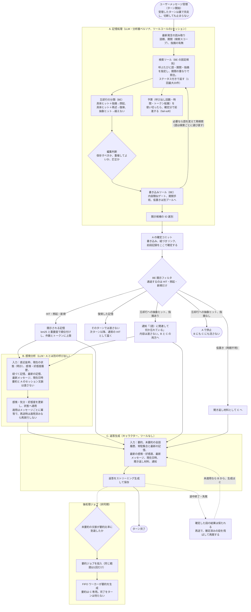

# 記憶処理フロー

対象読者：記憶処理の仕組みを知りたい開発者。

この図で、A・B・C は LLM の呼び出し、BE は Backend（バックエンド）の略で、FastAPI 側のプログラムを指します。

BE は LLM ではなくコードの固定規則で動き、検索の照合、書き込み時の検証、開示フィルタといったゲートキーピングはすべて BE が担います。

## 段階 A の検索

検索は1回で終わるとは限りません。
分析器は検索ツールを呼ぶたびに語、期間、指摘の有無を指定し、結果を見て、語を変えた再検索も行います（漏れの確認や、重複してよいかの判断のためでもあります）。

1回の検索で返るのは最大20件で、期間の重なりで照合し、忘却行もステータス付きで返ります。

どの語にもヒットしなかった語は覚えられていて、そのセッション（または次ターン）で別の検索が記憶に届いたとき、その記憶の抽象語として学習されます。言い回しのずれで届かなかった事実に、次回は同じ言い回しで届くようになります。

## 想起と復帰

忘れられた記憶（忘却行）が検索にヒットしたときの扱いは、ヒットの仕方と、ユーザーがその事実を指し示しているか（指摘）で決まります。
判定は、検索のたびに BE が行います。

- 具体ヒット（内容または具体語への一致）で、指摘がある場合は**想起**です。
  その場で再活性化され、このターンの開示に乗ります。
  想起は強い強化で、想起のたびに回数が増えて実効半減期が倍率で伸びるため、想起される記憶はだんだん忘れにくくなります。
- 具体ヒットで、指摘がない（事実が単に再び述べられただけの）場合は**復帰**です。
  その場で再活性化されますが、このターンでは開示されません（その事実は、ユーザーの言い直しとして既に会話の中にあるためです）。
  次のターン以降は、通常のヒットとしてキャラクターに届きます。
  復帰は想起として数えず、復帰の簿記にだけ記録されます。
- 抽象ヒット（抽象語だけの一致）の場合は、決して越えません。
  指摘があれば、「（ヒットした語）に関連して何か忘れている」という通知になり、内容は渡さずに B と C へ伝わります。
  指摘が無ければ、検索は本当のノーヒットとは区別される `forgotten_undisclosed` を返し、段階 A の重複判断がそれを頼りにします。

開示フィルタは LLM が選別した記憶 ID をもとに、件数とトークンの上限のもとで、bm25 と重要度により順位付けを行い再選別します。また、万が一 LLM が B・C へ開示すべきではない記憶の ID を選別していた場合、ここで除外されます。

BE によって再選別されて通過するのは、通常のヒット、想起された記憶、このターンに新しく保存された記憶だけです。

## 原則

- ゲートキーピングはすべて BE 側にあります。
  ヒット条件、開示、重複の判定はコード側の固定規則で決まり、LLM の裁量で変更することはできません。
- 想起と復帰の判定は、検索時に BE が行います。開示フィルタは、渡すかどうかだけを決めます。
- 登録の材料はユーザーの発言だけです。検索で返った内容（期間指定や前後 ±n で辿ったものを含む）は参照専用で、登録の材料にはなりません。
- 時間の形はカテゴリで変わります。状態は期間、出来事は日付時刻（点）です。検索の時間指定と、登録する記憶の時間は別々に扱います。
- 忘却行の内容がキャラクター側へ届く経路はありません。
  A と B・C を分離しているのはそのためです。
- 現在日時は全段階に既定で渡します。
